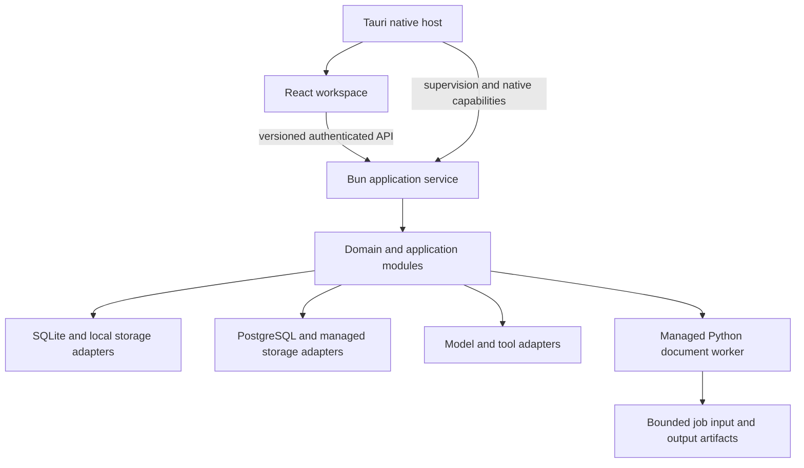

# 02. Architecture and domain ownership

## 1. Architectural form

Build a modular monolith with a desktop host, a React interface, one application service, and managed document workers. Modules have separate public interfaces and ownership boundaries, but ordinary application operations run in one Bun service. Introduce a separate service only when an actual deployment or isolation requirement justifies it.



The application service owns application state transitions. React owns presentation and temporary interaction state. Tauri owns native integration and process lifecycle. Python owns explicit worker operations such as extraction and OCR. A worker never independently opens the application database or introduces a second authority for document state.

Avoid distributing business logic between React effects, Rust commands, Python handlers, and database triggers. Domain rules live in domain/application modules and are exercised without rendering a screen.

## 2. Runtime composition

### Desktop

The Tauri host starts a compiled Bun service executable for the current platform, waits for a bounded readiness response, and opens the UI. The service binds to an available loopback port. Authenticate every request with a random session credential supplied through a controlled bootstrap channel. Do not put credentials in URLs, command arguments, logs, localStorage, or exported diagnostics.

Use an authenticated native bridge for initial service discovery. Keep its session credential in frontend memory. Validate allowed origins and websocket/stream connections as well as ordinary API calls. Loopback access alone is not authorization. Do not disable webview security to simplify setup.

The host manages a single application instance per data directory, worker startup/shutdown, and child process cleanup. On Windows use appropriate process lifetime control; on other systems use equivalent process supervision. An application crash must not leave indefinitely running orphan workers. On restart, recover drafts and mark interrupted jobs honestly.

Compile Bun and package Python workers for every supported operating system/architecture. Sidecar names and resources follow Tauri target conventions. Lock Python dependencies with uv and build isolated worker executables or an equivalently self-contained distribution. The installed app must not run pip or expect a user's Python installation.

Large OCR/model resources may be downloaded separately with explicit size, license, checksum, progress, cancellation, and offline behavior. Distinguish optional resources from the resources needed for the advertised default document path.

### Hosted

Run the Bun service independently behind HTTPS, with managed storage, PostgreSQL/pgvector, sessions, and explicit authentication. Use the same contracts and UI. Replace native capabilities with browser/server adapters. A hosted browser cannot access arbitrary client files or server directories.

Desktop schedules execute while the desktop service is running. An always-on hosted service can execute continuously. Explain this in the scheduling UI. Do not pretend a closed laptop runs jobs; do not install a hidden background operating system service without a deliberate product decision.

### Compatibility

Publish a compatibility manifest containing app, API protocol, database schema, worker protocol, starter pack, and extension API versions. Startup checks mismatches before performing work. An old worker must not accept a new payload and guess its fields.

## 3. Ontology: entities and single owners

Define these terms in `architecture/domain.catalog.json` with stable IDs, owner module, description, identifiers, persistence, and links to contracts. Generate the human-readable glossary from it. Do not create a second editable glossary with competing meanings.

| Owner module | Owns | Responsibilities and boundary |
| --- | --- | --- |
| workspace | Workspace, AuthorizedRoot, LayoutState | Workspace identity, allowed roots, pane and tab restoration; does not write document contents. |
| files | FileRecord, FileVersion, FileOperation | Filesystem access, safe writes, version hashes, external change events, recovery actions. |
| editor | EditorSession, Draft, EditProposal | Buffers, selections, undo, proposed patches, conflict interaction; saves through files/documents ports. |
| documents | SourceDocument, SourceVersion, ExtractionArtifact, SourceAnchor | Canonical source identity, immutable versions, format handling, previews, extraction, locators. |
| knowledge | Collection, Chunk, EmbeddingIndex, RetrievalResult | Collection membership, derived indexes, retrieval/ranking, access-filtered citation candidates. |
| providers | ProviderConnection, ModelDescriptor, ProviderCapability | Provider adapters and model capability discovery; credentials via an external secret port. |
| chat | Conversation, Message, MessageBranch, ChatRun | Message graph, context assembly, streaming coordination, durable conversation history. |
| methods | MethodDefinition, MethodVersion, Preset, Prompt, Skill | Versioned instructions and settings; starter pack upgrade rules. |
| tools | ToolDefinition, ToolConnection, ToolInvocation, CapabilityGrant | Tool schemas, authorization, MCP/OpenAPI integration, invocation lifecycle. |
| reviews | ReviewRun, ReviewPass, ReviewFinding, VerificationDecision | Five review workflows, provenance, pass ordering, human verification. |
| jobs | Job, Attempt, Lease, JobEvent | Durable queue/execution lifecycle; does not decide a review's substantive meaning. |
| research | SearchRequest, WebCapture | Web search/fetch, capture provenance, conversion into document sources. |
| automations | AutomationDefinition, Schedule, ScheduledOccurrence | Schedules and missed-run policy; execution delegated to jobs. |
| calendar | CalendarEvent, Recurrence | Events, timezone-aware recurrence, links to scheduled work. |
| media | MediaAsset, CaptureSession, MediaGenerationRun | Images/audio/video, device/provider adapters, generated artifact handling. |
| memory | MemoryEntry, MemoryScope | Opt-in memory, explicit inclusion, editing and deletion. |
| identity | Principal, Group, Membership, AccessPolicy | Local owner and hosted identities, authorization decisions, access revocation. |
| collaboration | Channel, ChannelPost, ShareGrant, DocumentRevisionRequest | Shared discussion and document collaboration through owner module ports. |
| exports | ExportJob, ExportManifest, ImportReport | Portable formats, workspace bundles, provenance and import validation. |
| settings | PreferenceDefinition, PreferenceValue | Validated preferences, migration and scope; no secret values. |

Foundation packages are `contracts`, `ui-kit`, `runtime`, and `test-kit`. They contain transport definitions, common visual primitives, process/telemetry adapters, and test fixtures respectively. They must not become a second home for domain rules. Put a reusable file version rule in the files module, not in `shared/utils`.

The complete catalog can describe planned modules. Actual module directories and manifests are created only as implementation reaches them. The repository map must distinguish planned catalog entries from present modules.

## 4. Dependency direction

Within a module:

```text
adapters → application → domain
```

Domain code imports no database, network, filesystem, React, Bun-specific, or native runtime implementation. Application code declares ports and orchestrates use cases. Adapters implement those ports. The application composition roots instantiate adapters and connect modules.

A module must not import a peer module's internals or open its tables. Cross-module dependencies are wired through explicit ports at the composition root. Shared transport contracts may describe data exchanged at boundaries. If a domain concept needs another domain's identity, use a typed identifier and a narrow port; do not copy that domain's state machine.

Expose explicit runtime-specific package exports:

- `@studio/knowledge/domain`: pure domain types and rules.
- `@studio/knowledge/service`: application factory, port types, service-side adapters intentionally exported for composition.
- `@studio/knowledge/ui`: UI entry component and public UI contracts.

The UI cannot import `/service`. Domain code cannot import `/ui`. Test-only helpers are not production exports. Check runtime imports, type-only imports, dynamic import targets, generated code, and package export maps. An interface-only dependency can still violate ownership.

## 5. Data authority and document fidelity

### Files and rich documents

A normal text/Markdown/code file's bytes are authoritative. Database records hold identity, metadata, version references, and recoverable drafts. They do not silently become a competing canonical copy. A file version records its content hash and observed filesystem state.

Rich notes use a documented, versioned portable document format, for example `.studio-document.json`, based on a constrained ProseMirror schema. That file is authoritative. Markdown, HTML, PDF, and DOCX are exports with explicit fidelity information. Plain Markdown opens in source mode unless its conversion is known to preserve required constructs. Do not continuously round-trip arbitrary Markdown through a rich schema and claim lossless editing.

Use Tiptap's open source core and suitable open source extensions. Do not make a required editing, collaboration, or export feature depend on a Pro license or vendor cloud service by accident. Use separately licensed open source conversion/collaboration adapters where needed, and include their real notices and package resources.

Write through a single file service: validate authorization and expected version, write a sibling temporary file, flush where supported, and replace atomically where supported. Record recovery information for environments without the same guarantees. Filesystem changes and database changes are not one atomic transaction. Use a journal/outbox and reconciliation on restart.

Detect external changes with debounced watchers plus validation before save. Resolve symlinks and canonical paths; handle Windows case equivalence, reserved paths, UNC behavior, and files moved outside an authorized root. Never derive authorization from a string prefix alone.

### Sources and citations

Source versions are immutable records of the material used for an operation. A `SourceAnchor` includes source ID/version, extraction version/hash, location kind, and location data. Standardize page numbering as one-based. Define text offsets against a precise representation such as UTF-8 bytes in the stored normalized extraction; never mix them with JavaScript UTF-16 offsets without conversion.

Preview anchors resolve back to the source page or text range. Preserve mappings for OCR and document transformations. A citation label alone is not an anchor. If the location cannot be resolved, show the citation as unverified and retain the underlying source reference.

### Knowledge indexes

Store extracted artifacts, chunk boundaries, extractor version, chunker configuration, source version, embedding model identity, dimensions, distance metric, and index version. Embeddings are derived data that can be rebuilt. Never mix different embedding spaces just because their vectors have the same dimension.

Use full-text and vector retrieval through an adapter with explicit ranking behavior. Apply access policy before returning snippets or citations, then recheck access when opening a result. Delete/revoke operations invalidate caches and queued operations. Record which source versions were used in the final context.

Probe sqlite-vec in packaged Bun builds early, especially on macOS where SQLite extension loading needs appropriate SQLite packaging. A developer-machine Homebrew library path is not a distributable solution. If sqlite-vec fails a target, choose a maintained local vector adapter through an ADR and the same retrieval interface. Do not drop vector search.

## 6. APIs, contracts, and streaming

Use JSON Schema Draft 2020-12 as the canonical external contract format. Validate at runtime and generate TypeScript/Python types from the same source. HTTP routing may use a maintained lightweight Bun-compatible framework; transport selection does not decide domain design. Generate OpenAPI where appropriate and keep a versioned event protocol for streaming.

Every event envelope includes protocol version, event ID, run ID, correlation ID, monotonic run sequence, timestamp, event type, and validated payload. Distinguish text deltas, complete messages, tool argument fragments, validated tool requests, tool results, source attachments, usage, completion, and failure.

Buffer incomplete tool JSON until complete and schema-valid. Do not execute a partial function call. Provider adapters translate their stream semantics into the canonical protocol and report capabilities honestly. Some models support images, tools, structured output, or reasoning fields differently. Unsupported settings must not be silently accepted.

Use authenticated streaming fetch/SSE or an equivalent transport with reconnect and replay semantics. Persist appropriate event checkpoints and message segments. Reconnecting the UI can resume reading stored events. Restarting the service cannot necessarily resume a provider generation; mark it interrupted and offer a new attempt. Keep partial output distinguishable from a completed answer.

Context assembly is inspectable: selected sources, retrieved chunks, memory entries, instructions, tool definitions, truncation policy, and token estimate. Respect model limits without silently dropping the source material the user intended to review.

## 7. Tools, reviews, and jobs

Tool definitions declare input/output schemas, effects, permission needs, timeout, cancellation behavior, and retry classification. MCP and OpenAPI discovery does not grant execution rights. A network tool is not equivalent to a file write tool.

Default file mutations produce proposals against a known version. Explicit user grants may permit bounded automation, but grants identify scope, operation, lifetime, and revocation. Treat arbitrary Python/JavaScript plugins as executable code requiring process isolation and deliberate trust. Do not claim that a subprocess alone is a secure sandbox.

Reviews orchestrate existing method definitions and tools. A new typed `ReviewRun` store is an intentional extension of the current app's chat-carried records. It must preserve raw prompts/results and provenance; structured findings do not overwrite original model output or imply human verification.

Jobs use states `queued`, `running`, `waiting-user`, `succeeded`, `failed`, `cancelled`, and `interrupted`. Attempts have leases/heartbeats, deadlines, progress, and cancellation signals. Inputs carry stable idempotency keys where appropriate. A provider timeout does not prove the external action never happened. Unknown outcomes of mutating tools require reconciliation, not blind retry.

The job engine persists transitions, while modules own their business results. Indexing can resume by source/chunk checkpoint. THM can retain completed passes. A schedule records occurrences so a restart cannot silently execute the same scheduled mutation twice.

## 8. Authorization, privacy, and recovery

Local mode has an explicit local owner and authorized filesystem roots. Hosted mode authenticates principals and checks workspace/group/resource policy on every route, background operation, retrieval, export, and source-opening operation. Hiding a sidebar item is not access control.

Use the operating system keychain through a credential adapter on desktop, and configured secret storage on servers. The renderer receives connection status and nonsecret metadata. Do not return stored provider credentials to populate a settings form. Redact secrets, prompts, and source content from default logs.

Document and web content is untrusted input. It cannot grant permissions or override tool policy. Sanitize rendered HTML/Markdown, constrain embedded resources, and isolate document previews as appropriate. Protect fetch tools against unintended internal network access in hosted deployments. Keep local-user-approved endpoints possible through explicit policy.

Provide backups and migration recovery before destructive schema changes. Run migrations through one coordinator, record module ownership for each migration, and back up data before an irreversible migration. Test restoring the backup; a theoretical down migration is not a recovery strategy. Keep portable exports separate from operational database backups.

## 9. Interface performance

Virtualize long message lists and large explorer results. Paginate stored history and bound client caches: a small DOM does not prevent a huge in-memory conversation. Stream updates into the active message without reparsing every previous message on each token.

Keep expensive extraction, embedding, syntax analysis, and large previews off the interaction path. Mount expensive editor/preview instances only when needed. Bound concurrent jobs, expose resource-heavy work, and release idle model/worker resources where possible.

Measure the entire process tree, including the webview, Bun, Python, and optional local model processes. Tauri can avoid shipping an Electron Chromium runtime; it does not guarantee low memory for the finished workload. Performance targets and evidence belong in the release document.

## 10. Extension contract

New capabilities declare their owner, public contracts, data ownership, permission requirements, events, migrations, UI surfaces, tests, and version compatibility. Most product additions should be internal modules. Third-party extensions require a separate versioned manifest and explicit trust model.

An extension cannot import internal application paths or access all tables by convention. Provide a bounded SDK for approved operations. Add extension isolation only when implementing actual third-party execution; do not build a speculative marketplace before the workspace works.
