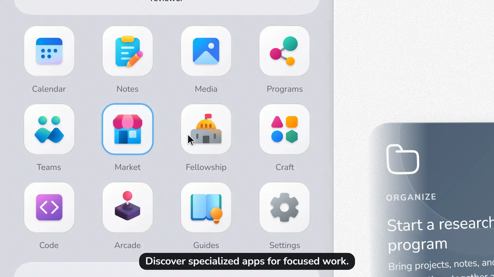
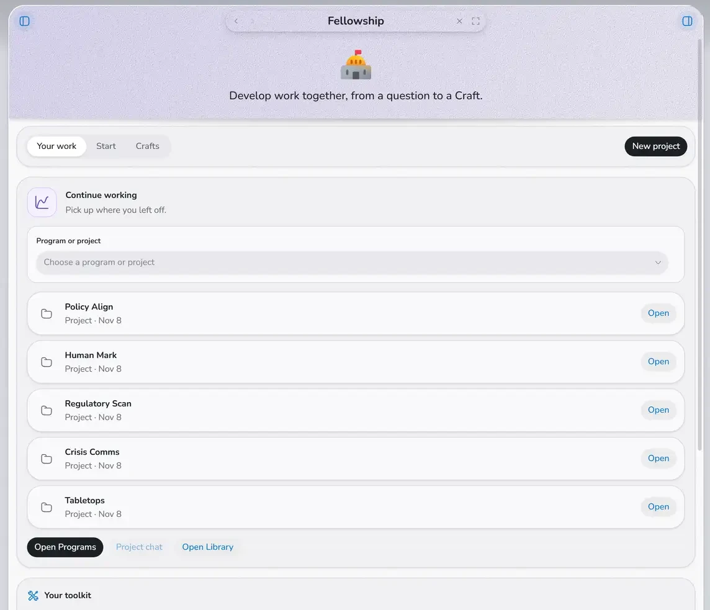
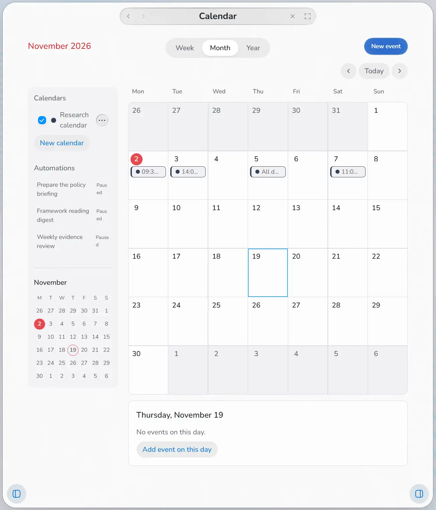
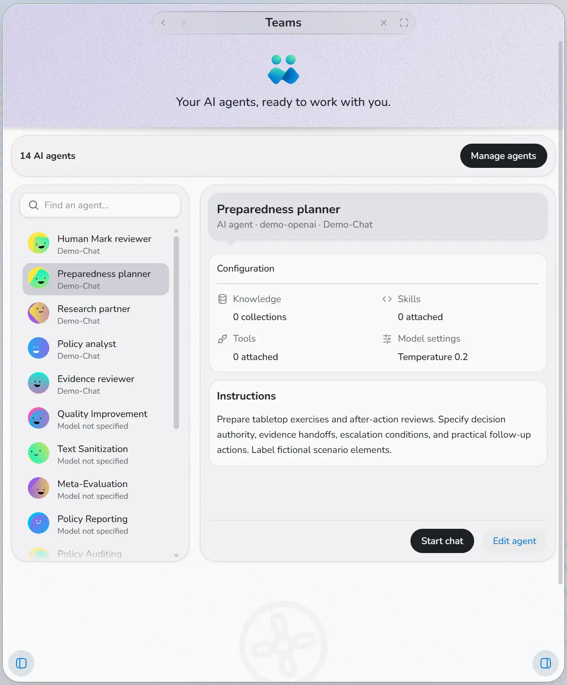
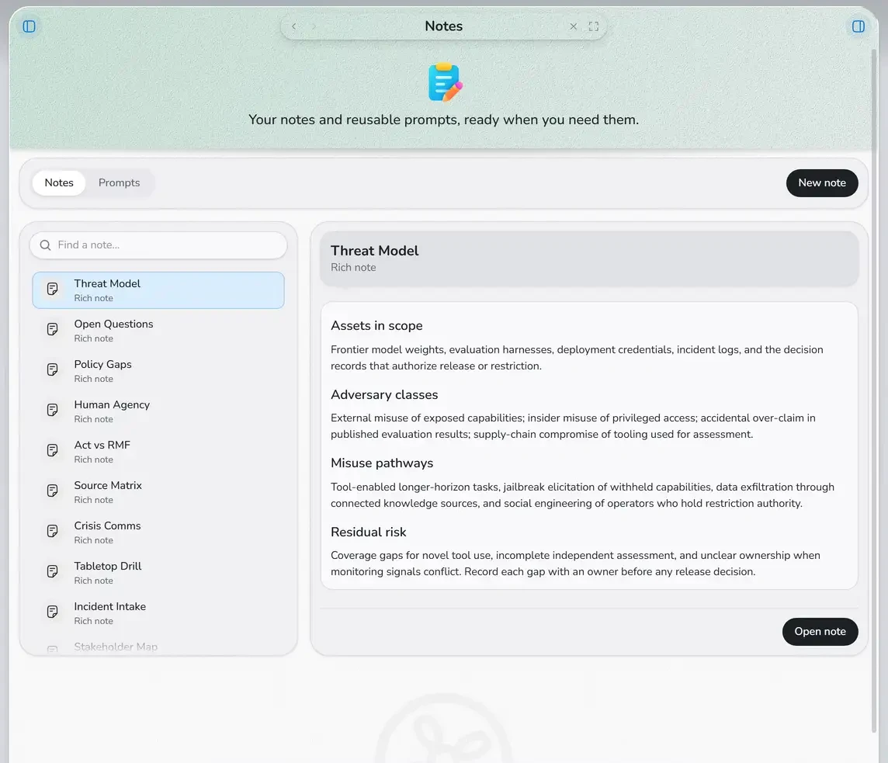
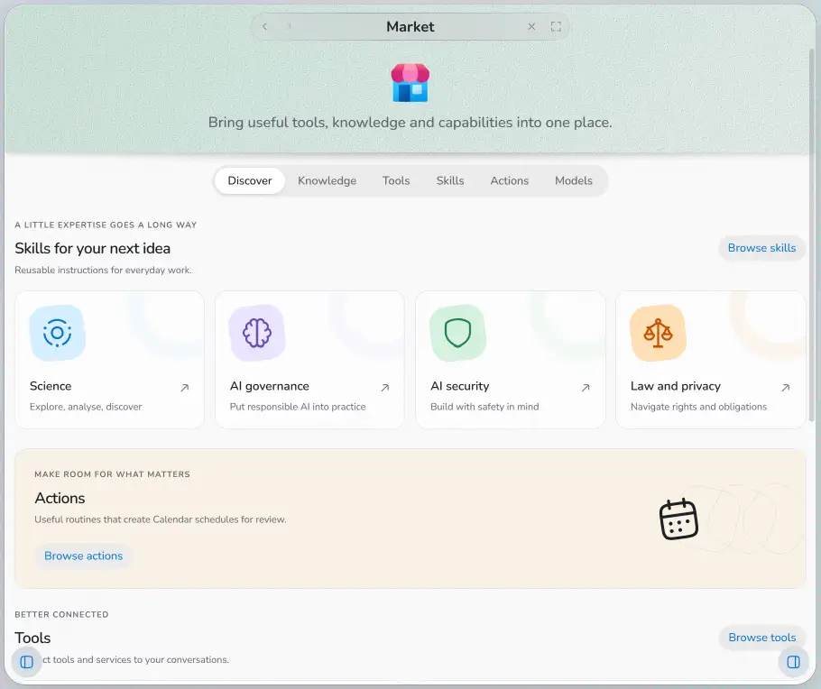
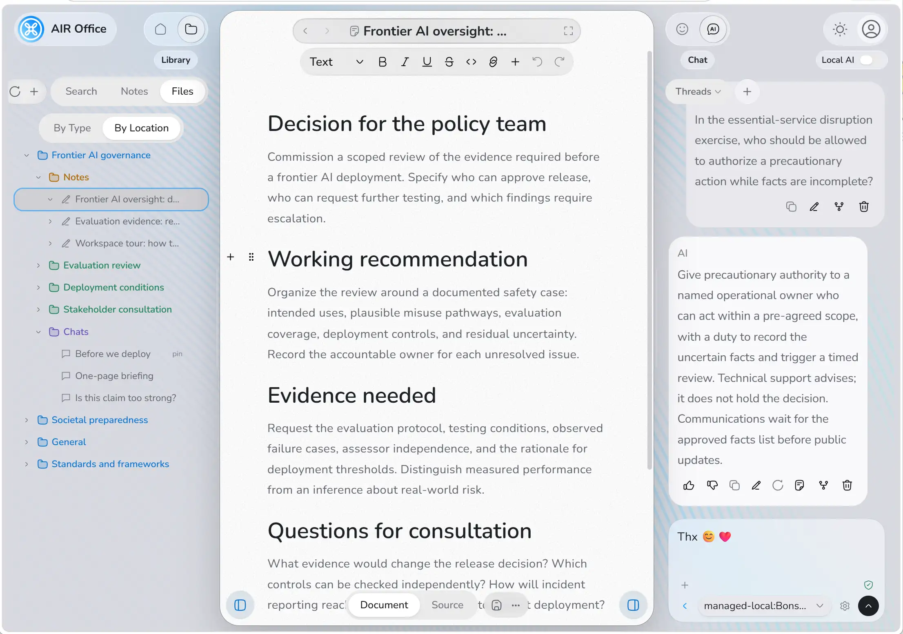
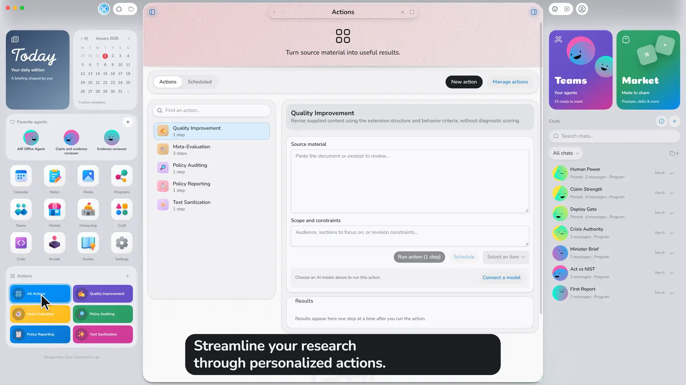
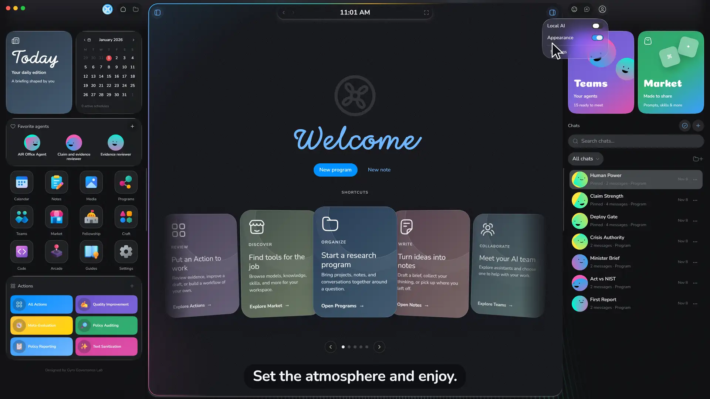

# AIR Office

An AI-native desktop workspace for agentic research and knowledge management, built to maximize counterfactual impact in existential risk preparedness and transformative AI safety.


[About](#about) · [Capabilities & Services](#capabilities--services) · [Products & Workflows](#products--workflows) · [Security & Privacy](#security--privacy) · [Documentation](#documentation) · [Alpha release](#alpha-release) · [Community](#community) · [Citation](#citation)

---

## About

**Alignment Infrastructure Routes (AIR) Office is human-capacity-building infrastructure for AI safety researchers, engineers, and governance teams working on transformative AI and its consequences. It keeps investigation, writing, review methods, and reusable tools in one durable and user-friendly workplace.**

https://github.com/user-attachments/assets/2fba87a3-5de3-4c72-8804-43e607348d84

AIR Office is developed by [Gyro Governance Lab](http://gyrogovernance.com/) as part of its work on AI safety and existential risk preparedness.

Agentic chat and tool use run on the [Microsoft Copilot SDK](https://github.com/github/copilot-sdk) harness, including bring-your-own-key and local model endpoints.

### Theory of Change

Mitigating risks from transformative AI requires rapid, high-rigor research and governance, yet safety teams currently rely on fragmented, cloud-dependent AI tools that erode human oversight, lack provenance, and expose sensitive work. AIR Office addresses this bottleneck by providing free, open-source, local-first desktop infrastructure tailored for AI safety and policy workflows. By integrating grounded knowledge collections, automated auditing tools, and structured memory, the workspace prevents AI-induced epistemic drift while keeping humans in final control. Furthermore, embedded Fellowship and Market protocols allow independent researchers to package their methods into reusable community tools, compounding ecosystem capacity and accelerating high-trust safety interventions that would not occur using general-purpose commercial tools.

---

## Capabilities & Services



- 🏛️ **Integrated AI Safety Fellowship and Crafts.** Develop research and workflows into reusable infrastructure and contribute them to the community through our frictionless embedded protocols.
- 🛒 **Market.** Discover reusable resources (Policy documentation, AI Skills, etc), and add them to your AI chat with one click.
- 🤖 **AI Teams.** Reach out to our pre-configured selection of agents, or create your own.
- 💻 **Code.** Run diagnostic tools, scripts, and edit your code without leaving the app, through our own integrated VS Code workbench.
- 📅 **Calendar.** Keep events and run recurring AI automations.
- ⚖️ **Compare.** Run two models side by side on the same prompt.
- 🔎 **Chat.** Edit local files, search the web, and run AI safety diagnostics directly from the chat interface.
- 🖼️ **Media.** Generate images and capture microphone or camera input when the work needs it.
- 🕹️ **Arcade.** Release stress and recover from occupational overburn by playing arcade video games.

|                                                                                          |                                                                                          |
| ---------------------------------------------------------------------------------------- | ---------------------------------------------------------------------------------------- |
|     |  |
|     |  |




---

## Products & Workflows

### Grounded Knowledge Management

Build searchable Knowledge collections from reports, papers, specifications, legislation, and standards, then ask your AI agent for grounded answers and follow up drafts. Rich-text Notes hold literature synthesis, evaluation write-ups, design docs, memos, and chat history, all at direct reach by you and your favorite AI automations.



> Seeded reference standards include the **EU AI Act**, the **NIST AI Risk Management Framework**, the **NIST Generative AI Profile**, and the **OECD AI Principles**. Companion collections for development and evaluation work cover **UN SDG goals**, **OECD-DAC evaluation**, and **UNDP DPI** guidance, with NGO Playbook evidence notes available alongside them. Each collection records its edition and source, and you can add your own research and guidance beside them.

### Specialized AI Actions

Actions are ordered AI workflows you create, adapt, or schedule for review, reporting, preparation, or any multi-step method your practice needs. 



**AI safety and governance startup kit:**
- **✍️ Quality Improvement** reviews structure, evidence, alternatives, and uncertainty.
- **🔎 Policy Auditing** connects claims to evidence and flags unsupported claims.
- **📋 Policy Reporting** prepares attributed reports with recommendations and limitations.
- **🧭 Meta-Evaluation** reviews provenance and accountability.
- **✨ Text Sanitization** removes AI slop and fixes formatting problems.

---

***Actions are ported from our Chrome Extension [AI Inspector](https://gyrogovernance.com/#inspector).***

---

> While humans remain responsible for continuous oversight and final judgement, AIR Office helps your AI be aware of that and leverage its capacity for aligned augmentation.

---

### Frontier AI Safety Research Tools by Gyro Governance Lab

Two Lab methods sit at the center of how AIR Office treats authority, agency, and lasting human direction in AI-assisted work.

- **🤚 The Human Mark:** A structural taxonomy of AI safety risks. [Learn More](https://gyrogovernance.com/#thm)

- **🎓 Gyroscopic Reasoning [NEW]:** A formal protocol for AI alignment. [Learn More](https://gyrogovernance.com/#gyroscope)

### Community Playbooks

Craft Standards package skills, agents, and Actions you can enable for structured work instead of ad-hoc prompting. Two shipped playbooks are ready to adopt:

- **🛡️ Security Playbook:** OWASP-grounded assessment methods for AI agents, applications, and code, with companion security Reference packs. [Learn More](https://owasp.github.io/secure-agent-playbook/)
- **🌍 NGO Playbook:** Program design, SDG alignment, monitoring and evaluation, and funding strategy skills adapted from NGO Agent Skills by Lijie Zhou, with related development Reference packs. [Learn More](https://github.com/LijieZhou/ngo-agent-skills)

---

## Security & Privacy

### Local-First Data Sovereignty

Workspace records stay on your computer. Choose local models for on-machine inference or cloud providers for their models and tools. Hosted providers and enabled connectors receive only what each request needs.

Export conversations and notes when you need portable copies. Connecting a folder authorizes that root, and disconnecting it does not delete its files. In Settings and chat you control which tools run and whether changes ask for approval first. A fuller privacy and data-control summary is in [docs/sovereignty.md](docs/sovereignty.md).

### Release Audit

AIR Office is open source, and its code can be publically inspected. Before a release is accepted, we check the shipped software with open-source tools for secrets that should never ship, known problems in third-party libraries, license and dependency policy issues in native code, and risky patterns in our own source and in shipped Lab skills. A review that did not finish does not count as a clean result. To report a security issue, see [SECURITY.md](SECURITY.md).

The release review uses:

- [TruffleHog:](https://github.com/trufflesecurity/trufflehog) Identifies leaked secrets and credentials.
- [Trivy:](https://trivy.dev/) Detects vulnerabilities, misconfigurations, and software bills of materials.
- [Semgrep:](https://semgrep.dev/) Scans source code for security flaws using custom patterns.
- [CodeQL:](https://codeql.github.com/) Performs deep semantic analysis on source code.
- [SkillSpector:](https://github.com/NVIDIA/SkillSpector) Evaluates shipped Lab skills.

---

## Documentation

Technical documentation for operators and contributors:

- [Documentation index](docs/README.md)
- [Specifications](docs/specifications.md)
- [Guides](docs/guides.md)
- [Sovereignty](docs/sovereignty.md)

---

## Alpha Release



**[0.1.0-AIR_Office_Alpha](https://github.com/gyrogovernance/air-office/releases/tag/0.1.0-AIR_Office_Alpha)** is the first public desktop build.

| Platform | Download |
| --- | --- |
| Windows (x64) | [AIR-Office-Setup-0.1.0-x64.exe](https://github.com/gyrogovernance/air-office/releases/download/0.1.0-AIR_Office_Alpha/AIR-Office-Setup-0.1.0-x64.exe) |
| macOS Apple Silicon | [AIR-Office-0.1.0-arm64.dmg](https://github.com/gyrogovernance/air-office/releases/download/0.1.0-AIR_Office_Alpha/AIR-Office-0.1.0-arm64.dmg) |
| macOS Intel | [AIR-Office-0.1.0-x64.dmg](https://github.com/gyrogovernance/air-office/releases/download/0.1.0-AIR_Office_Alpha/AIR-Office-0.1.0-x64.dmg) |

These builds are unsigned alpha packages. On macOS you may need to open the app from System Settings → Privacy & Security after the first launch. Features may change, and the software can be unstable.

If you want to report a problem, open an [issue](https://github.com/gyrogovernance/air-office/issues). Include the app version, the OS, the model, and the steps to reproduce, and strip API keys and private document content.

Full notes: [CHANGELOG.md](CHANGELOG.md).

---

## Community

- [Contributing](CONTRIBUTING.md)
- [Code of Conduct](CODE_OF_CONDUCT.md)
- [Security policy](SECURITY.md)
- [Changelog](CHANGELOG.md)
- [License](LICENSE)
- [Third-party notices](THIRD-PARTY-NOTICES.md)

---

## Citation

If you use AIR Office in academic or policy work please cite it.

```bibtex
@software{air_office_2026,
  author       = {Korompilias, Basil and Gyro Governance Lab},
  title        = {AIR Office},
  year         = {2026},
  version      = {0.1.0},
  publisher    = {Gyro Governance Lab},
  url          = {https://github.com/gyrogovernance/air-office},
  license      = {MIT}
}
```

Korompilias B. and Gyro Governance Lab. 2026. *AIR Office* Version 0.1.0. Computer software. https://github.com/gyrogovernance/air-office

A machine-readable record is also provided in [CITATION.cff](CITATION.cff).

---

## Acknowledgements

Including framework references does not imply endorsement by their publishers. Third-party software, fonts, artwork, and runtimes are attributed in [THIRD-PARTY-NOTICES.md](THIRD-PARTY-NOTICES.md).

