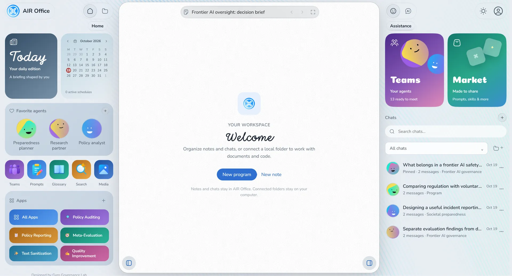
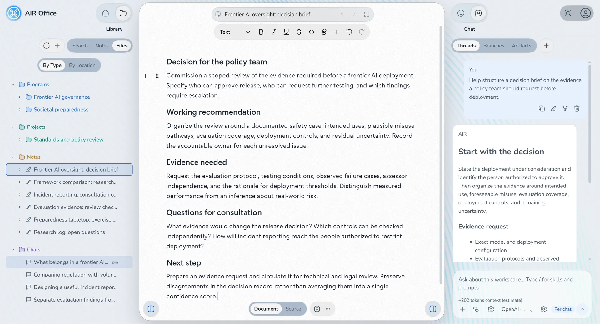
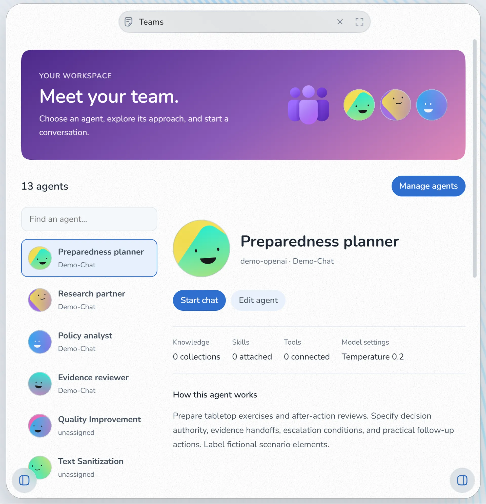
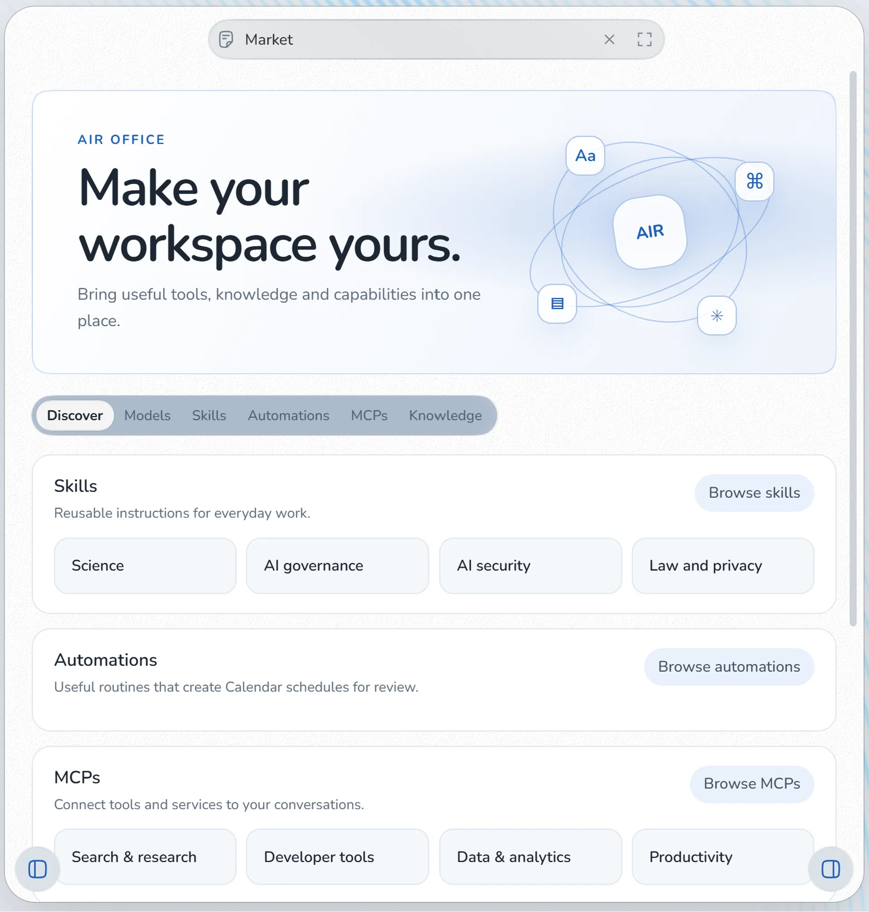

  

<h1 align="center">AIR Office</h1>

  An AI-native workspace for agentic research, policy analysis, and knowledge management, focused on mitigating risks from transformative AI and advancing existential risk preparedness. 
  <strong>Coming soon</strong>

  <a href="#what-you-can-do">What you can do</a> ·
  <a href="#your-models-and-your-data">Your data</a> ·
  <a href="#status">Status</a>

AIR Office brings sources, AI conversations, and working documents into one workspace for people who prepare analysis on transformative AI and its consequences. It is built for researchers, policy analysts, and governance teams who need to examine evidence, develop a position, and carry their work from first reading through to a brief that can be shared with decision-makers.

AI-assisted research sits alongside your own reading and writing. You can bring document collections into a conversation, use review tools, and work through multi-step tasks while retaining responsibility for the questions, corrections, and final judgement. Exchanges stay beside your notes and sources, so the reasoning behind a conclusion remains available for colleagues, reviewers, and policymakers.

AIR Office is developed by [Gyro Governance Lab](http://gyrogovernance.com/) as part of its work on AI safety and existential risk preparedness. Selected review tools come from the Lab’s [AI Inspector](https://github.com/gyrogovernance/apps) work.

  

## Designed for Good Governance

AIR Office supports people who carry research from analysis through to policy design and stakeholder engagement.

- **Researchers** who own a policy area end to end, from evidence review to the published brief and its dissemination.
- **Policy advisers** working with governments, public institutions, and international bodies on frontier AI, safety, and governance.
- **Think tanks** and independent foundations building AI-native practices for research and knowledge management.
- **Technical and governance teams** reviewing evaluation reports, risk assessments, and internal guidance.

Typical work includes the following.

- **Briefings** on AI safety, governance, and existential risk preparedness
- **Consultation** responses and comments on draft regulation and standards
- **Comparisons** between a proposal and established frameworks such as the EU AI Act or the NIST AI Risk Management Framework
- **Research** on competitiveness, industrial policy, metascience, and societal resilience as AI capabilities grow
- **Reviews** of model evaluation documentation and system prompts

## What you can do

### Research with your sources in one place

- **Programs and Projects** organize related notes, conversations, and connected local folders around a research project or policy area.
- **Knowledge** holds reports, papers, legislation, and standards in searchable collections that you can draw on during a conversation.
- **Notes** give you an editable document for the brief, memo, or response you are developing, with rich-text formatting and attachments.
- **Chat history and search** let you return to an earlier exchange, follow its branches, and see how a conclusion was formed.

A typical session might begin with several reports on the same policy question. You ask for a synthesis that separates where the sources agree from where they diverge, question the points that seem weakly supported, and develop the result into a briefing note while the sources and the discussion remain open beside it.

  

### Review a draft with dedicated tools

Five review tools come from AI Inspector, the Gyro Governance Lab browser extension for evaluation and governance. They are available as dedicated Apps and in chat for models that support tool calling.

- **Policy Auditing** separates a document's claims from the evidence offered for them, shows how the two relate, and flags claims that have no stated support.
- **Policy Reporting** prepares an executive report with source attribution, recommendations, the reasons behind them, and an account of limitations.
- **Meta-Evaluation** examines information provenance and responsibility for decisions using [The Human Mark](http://gyrogovernance.com/), with proposed revisions where attribution or accountability is unclear.
- **Text Sanitization** removes hidden characters, irregular spacing, and formatting problems, and explains each change.
- **Quality Improvement** provides a review workflow for clearer structure, firmer grounding in evidence, fair treatment of alternatives, and open acknowledgement of uncertainty.

The final judgement stays with you. You can question a finding, ask for the passage that supports it, or request another revision in the same conversation, and conclusions and citations should still be checked against the original material before they are relied upon.

### Work from established frameworks

Reference collections cover the main international frameworks for AI governance and can be attached to any conversation.

- EU AI Act (Regulation (EU) 2024/1689)
- NIST AI Risk Management Framework (AI RMF 1.0)
- NIST Generative AI Profile (NIST AI 600-1)
- OECD AI Principles (2024 revision)
- The Human Mark, the Gyro Governance taxonomy for AI safety risks

Each collection is a dated edition with a recorded source. You can add national strategies, institutional guidance, and your own research alongside them.

### Repeat good work without starting over

Several workspace features help a team apply the same methods across many documents.

- **Agents** combine a model with standing instructions, selected tools, skills, and Knowledge collections. Lab presets cover claim and evidence review, research synthesis, policy and standards analysis, and Human Mark review.
- **Prompts** are saved instructions for recurring tasks, with variables for the details that change between uses.
- **Skills** hold longer sets of guidance for multi-step research and review work.
- **The glossary** explains workspace terms and the vocabulary of The Human Mark.

Teams presents a directory of agents so you can inspect their instructions and start a conversation with a selected research assistant, while Market brings model discovery, skills, MCPs, Knowledge collections, and automation templates into one place. Market resources install as editable copies, and automation templates arrive paused so their instructions and schedule can be reviewed before activation.

<table>
  <tr>
    <td align="center"></td>
    <td align="center"></td>
  </tr>
</table>

### Also in the workspace

Day-to-day research tools sit beside the governance-focused features above.

- **Automations** run saved prompts on a schedule and retain run history.
- **Calendar** organizes events and recurring work.
- **Playground** provides a separate place to try prompts and model settings without mixing that work into an active research thread.
- **Web search and page fetch** bring online sources into a conversation when those tools are configured.
- **Memory** stores selected facts for use across conversations when enabled.
- **Image and audio features** are available through compatible providers.
- **Markdown, mathematical notation, and code** are supported in conversation rendering.

Connect a local model or a hosted provider of your choice. Knowledge indexing uses the embedding model you select, so collections can be searched and drawn into chat.

## Your models and your data

Chats, notes, and workspace records stay on your computer. You choose where workspace data is stored and which local folders to connect for research files.

When you use a hosted model, the content needed for each request is sent to the provider you selected. Local models keep inference on your machine. External tools and web services make network requests only when you configure them.

The desktop application is designed for local use without account registration. Conversations and notes can be exported when you need portable copies.

## Status

AIR Office is in active development and is not yet publicly available. Installers and release notes will appear here when a first release is ready.

Questions and interest are welcome through [Gyro Governance Lab](http://gyrogovernance.com/). When reporting an issue after release, describe the task, the expected result, and what happened, along with the application version, operating system, and model. Remove API keys and private document content before sharing.

## Acknowledgements

AIR Office is developed by Gyro Governance Lab. Review tools and Human Mark material draw on the Lab’s AI Inspector and governance research. The Human Mark reference material is published under [CC BY-SA 4.0](https://creativecommons.org/licenses/by-sa/4.0/).

Including framework references does not imply endorsement by their publishers.
