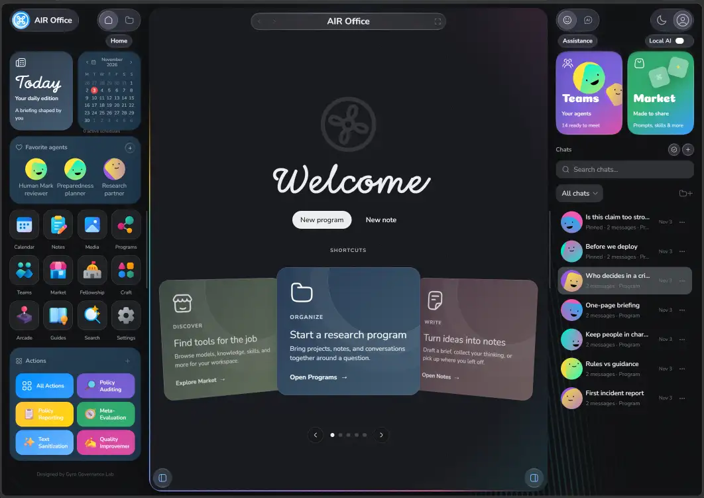

# AIR Office

An AI-native workspace for agentic research, policy analysis, and knowledge management, focused on mitigating risks from transformative AI and advancing existential risk preparedness.

[](CHANGELOG.md)
[](CHANGELOG.md)
[](LICENSE)
[](#alpha-release)
[](#your-models-and-your-data)
[](https://bun.sh)

[What you can do](#what-you-can-do) · [Your data](#your-models-and-your-data) · [Alpha release](#alpha-release) · [Community](#community) · [Citation](#citation)

AIR Office brings sources, AI conversations, and working documents into one workspace for people who prepare analysis on transformative AI and its consequences. It is built for researchers, policy analysts, and governance teams who need to examine evidence, develop a position, and carry their work from first reading through to a brief that can be shared with decision-makers.

AI-assisted research sits alongside your own reading and writing. You can bring document collections into a conversation, use review tools, and work through multi-step tasks while retaining responsibility for the questions, corrections, and final judgement. Exchanges stay beside your notes and sources, so the reasoning behind a conclusion remains available for colleagues, reviewers, and policymakers.

AIR Office is developed by [Gyro Governance Lab](http://gyrogovernance.com/) as part of its work on AI safety and existential risk preparedness. Selected review tools come from the Lab’s [AI Inspector](https://github.com/gyrogovernance/apps) work.

[](assets/media/air-office-readme.mp4)

[Watch the AIR Office overview video](assets/media/air-office-readme.mp4)

---

## What you can do

### 📚 Research with your sources in one place

Organize notes, conversations, and connected folders into Programs and Projects. Build searchable Knowledge collections from reports, papers, legislation, and standards, then bring them into chat. Write briefs and memos in rich-text Notes, and return to earlier exchanges through chat history and search.

Use the workspace to prepare briefings and consultation responses, compare proposals with governance frameworks, or review model evaluations. Ask for a synthesis, question weakly supported points, and develop a briefing while the sources and discussion remain open beside it.

### 🔍 Review a draft with dedicated tools

Five review tools come from AI Inspector, the Gyro Governance Lab browser extension for evaluation and governance. They are available as Actions and in chat for models that support tool calling.

- **Policy Auditing** connects claims to evidence and flags unsupported claims.
- **Policy Reporting** prepares attributed reports with recommendations and limitations.
- **Meta-Evaluation** reviews provenance and accountability using [The Human Mark](http://gyrogovernance.com/).
- **Text Sanitization** explains and removes hidden characters and formatting problems.
- **Quality Improvement** reviews structure, evidence, alternatives, and uncertainty.

You can also create Actions from ordered instruction steps and run them on a schedule.

The final judgement stays with you. You can question a finding, ask for the passage that supports it, or request another revision in the same conversation, and conclusions and citations should still be checked against the original material before they are relied upon.

Reference collections include the EU AI Act, the NIST AI Risk Management Framework and Generative AI Profile, the OECD AI Principles, and The Human Mark. Each collection records its edition and source. You can add your own research and guidance alongside them.

### 🛠️ Repeat good work without starting over

Create agents with a model, instructions, tools, skills, and Knowledge. Save prompts for recurring tasks and skills for multi-step work. Fellowship brings ongoing Programs and Projects together with contributions based on that work; Craft contains curated Standards and Products and lets you package reusable resources.

|                                                                                          |                                                                                                                                            |
| ---------------------------------------------------------------------------------------- | ------------------------------------------------------------------------------------------------------------------------------------------ |
|     |                                      |
| **Teams** lets you inspect agents, start a conversation, or open an agent in the editor. | **Market** brings models and reusable resources together. Installs are editable copies, and automation templates arrive paused for review. |

### ✨ Also in the workspace

Calendar organizes events and recurring work, while Playground gives you a separate place to try prompts and model settings. Configure web search, page fetch, and memory for chat, or use image and audio features with compatible providers.

|                                                                         |                                                        |
| ----------------------------------------------------------------------- | ------------------------------------------------------ |
|   |          |
| **Automations** run saved prompts on a schedule and retain run history. | **Arcade** offers bundled games for a break from work. |

---

## Your models and your data

Chats, notes, and workspace records stay on your computer. You choose where workspace data is stored and which local folders to connect for research files.

Use local AI for privacy-sensitive work, with inference on your computer. Full agent capabilities are available for compatible models. Hosted providers receive the content needed for each request; configured external tools and web services can also send data over the network.

The desktop application is designed for local use without account registration. Conversations and notes can be exported when you need portable copies. Connecting a local folder authorizes access to that folder; disconnecting it does not delete its files.

You can enable tools and connectors in Settings. In chat, choose whether commands and tools that change data ask for approval or are allowed to run. Connector discovery alone does not enable its tools.

---

## Alpha release

Desktop alpha on Windows first; macOS and Linux packaging follow. Features may change. This is not legal, policy, or safety advice: treat model output as draft and check it against your sources.

Local disk for workspace data. Local models are optional. Cloud providers and connectors need their own accounts or API keys.

[Changelog](CHANGELOG.md) · [Releases](https://github.com/gyrogovernance/air-office/releases) · [Issues](https://github.com/gyrogovernance/air-office/issues) · [Gyro Governance Lab](http://gyrogovernance.com/)

Bug reports: app version, OS, model, and steps to reproduce. Strip API keys and private document content.

---

## Community

- [Contributing](CONTRIBUTING.md)
- [Code of Conduct](CODE_OF_CONDUCT.md)
- [Security policy](SECURITY.md)
- [Changelog](CHANGELOG.md)
- [License](LICENSE) (MIT)
- [Third-party notices](THIRD-PARTY-NOTICES.md)

---

## Citation

If you use AIR Office in academic or policy work, please cite it.

```bibtex
@software{air_office_2026,
  author       = {Korompilias, Basil and Gyro Governance Lab},
  title        = {AIR Office},
  year         = {2026},
  version      = {0.1.0},
  publisher    = {Gyro Governance Lab},
  url          = {https://github.com/gyrogovernance/air-office},
  license      = {MIT}
}
```

Korompilias, B., & Gyro Governance Lab. (2026). *AIR Office* (Version 0.1.0) [Computer software]. https://github.com/gyrogovernance/air-office

A machine-readable record is also provided in [CITATION.cff](CITATION.cff).

---

## Acknowledgements

Including framework references does not imply endorsement by their publishers. Third-party software, fonts, artwork, and runtimes are attributed in [THIRD-PARTY-NOTICES.md](THIRD-PARTY-NOTICES.md).


