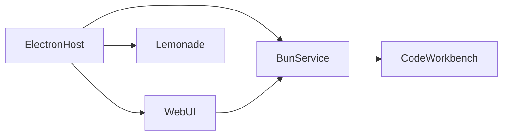

# Specifications

AIR Office is an AI-native desktop workplace for agentic research and knowledge management. Gyro Governance Lab (a research lab focused on AI safety and existential risk preparedness) builds it as capacity-building infrastructure for AI safety researchers, engineers, and governance teams working on transformative AI and its consequences.

Investigation, writing, review methods, and reusable tools stay together in one durable workspace on the operator's computer. Chat and tools run against models the operator configures locally or through cloud providers. The application ships the workplace and software that can run models on the machine. It does not ship a foundation model trained by Gyro Governance Lab.

Product overview: [README](../README.md). Lab site: [gyrogovernance.com](http://gyrogovernance.com/).

## How AI is used

Chat with tools (search, files, diagnostics, and similar) runs through the Microsoft Copilot SDK, including bring-your-own-key cloud endpoints and local model endpoints. To run models on the operator's computer without a hosted provider, the desktop app embeds an open local inference runtime called Lemonade. Lemonade does not include model weights; the operator supplies or downloads the models to run. Default local chat shares workplace permissions and memory with the rest of the product, and can use the Lab methods described below. Model quality and behaviour follow the models and providers the operator chooses. Humans keep continuous oversight and final judgement.

## Runtime architecture



The desktop shell is Electron. It runs a Bun process for application logic, serves the web UI, embeds Lemonade for local inference, and can start code-server (a browser-hosted Visual Studio Code workbench) when the operator opens the in-app coding surface on a trusted folder. Data placement, credentials, and what hosted providers receive are described in [sovereignty.md](sovereignty.md).

## Technology stack

Core dependencies at the 0.1.0 alpha (from repository manifests):

| Component | Role | Version |
| --- | --- | --- |
| Bun | Service runtime and toolchain | 1.4.4 |
| TypeScript | Language | 5.9.3 |
| Electron | Desktop host | 45.2.3 |
| React | UI | 19.3.0 |
| Vite | Web build | 6.4.4 |
| HeroUI | UI controls | 3.x |
| SQLite with sqlite-vec | Local stores and knowledge vectors | embedded |
| Microsoft Copilot SDK | Agentic chat and tools | SDK release pinned in the repo |
| Lemonade | Local inference runtime | 2026.42.1 |
| code-server | In-app code workbench | 4.144.0 |
| OS keychain | Provider credentials | platform native |

Hosted model providers and OpenAPI or MCP connectors are optional. Core chat and tool workflows run with local inference alone when the operator configures on-machine models through Lemonade, so a closed cloud provider is not a mandatory dependency of the product. Redistributed third-party components and licenses are listed in [THIRD-PARTY-NOTICES.md](../THIRD-PARTY-NOTICES.md).

## Lab methods

Two methods from Gyro Governance Lab ship inside the workplace.

AI-assisted work can fail when human authority or agency is displaced (for example when the model invents grounding, or when a person cannot tell who directed a conclusion). A structural taxonomy for those risks ships in the product as The Human Mark. [Overview](https://gyrogovernance.com/#thm)

Useful human direction often lives in a short stretch of dialogue: what the person asked, what the model answered, and what the person said next (a correction, acceptance, or new condition). AIR Office can keep those three-message units as lasting records so later work can recall them and so the operator can export them for learning. That method is named Gyroscopic Reasoning. [Overview](https://gyrogovernance.com/#gyroscope)

Operators can also enable packaged playbooks of agents, prompts, skills, and multi-step AI workflows instead of relying on one-off prompts. That packaging surface is Craft: packages appear as Standards (methods you enable) or Products (installable bundles). Two shipped playbooks cover OWASP-grounded security assessment for AI agents and applications, and NGO program design with SDG-aligned development work.

## Document libraries (Knowledge)

The assistant can search and cite document libraries the operator maintains. In the product those libraries are Knowledge collections. Operators build them from their own files and from shipped reference packs. Each catalogued file records edition, source, rights, and checksum metadata in [`packages/lab-pack/data/frameworks-v1.json`](../packages/lab-pack/data/frameworks-v1.json).

Default references include the EU AI Act, the NIST AI Risk Management Framework, the NIST Generative AI Profile, the OECD AI Principles, and The Human Mark materials. Opt-in packs include OWASP security references and NGO, SDG, OECD-DAC, and UNDP development materials. Upstream licenses appear in [THIRD-PARTY-NOTICES.md](../THIRD-PARTY-NOTICES.md).

## Closed-exchange records (Gyroscopic Reasoning)

Each retained unit under lasting dialogue memory is a completed user message, the assistant response that followed it, and the next completed user message. The third message may continue the task, correct the answer, express satisfaction, or set a new condition. Capture keeps the actual wording and does not assign an alignment label. That storage method is Gyroscopic Reasoning, introduced in Lab methods above.

The portable export row is JSON Lines: each line is a `messages` array of `{role, content}` objects. Record identity, capture time, and indexing state stay in a local envelope outside that row. Example row:

```json
{"messages":[{"role":"user","content":"Compare these plans by total cost."},{"role":"assistant","content":"The first plan has a lower acquisition cost."},{"role":"user","content":"Include maintenance costs."}]}
```

The same records support recall in later tasks and learning from exported exchanges; those uses are distinct. Export rules and privacy filtering for shared contribution are in [sovereignty.md](sovereignty.md).

## Multi-step AI workflows (Actions)

Operators can define ordered, multi-step AI workflows for review, reporting, preparation, and similar work, and can schedule them. In the product those workflows are Actions. A shipped kit includes Quality Improvement, Policy Auditing, Policy Reporting, Meta-Evaluation, and Text Sanitization.

## Release identity

Version 0.1.0 (`0.1.0-AIR_Office_Alpha`) is the first public desktop alpha. License: MIT. Citation: [CITATION.cff](../CITATION.cff). Release notes: [CHANGELOG.md](../CHANGELOG.md).
